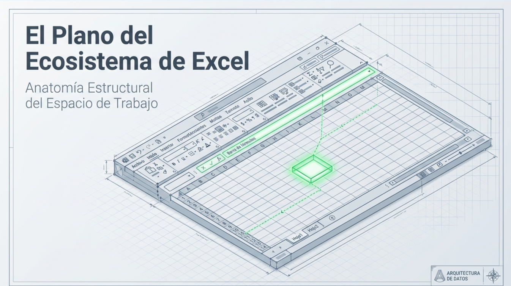
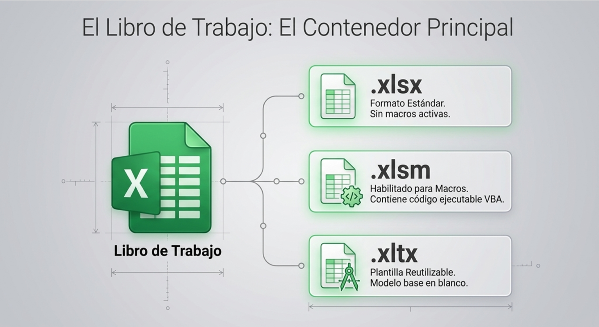
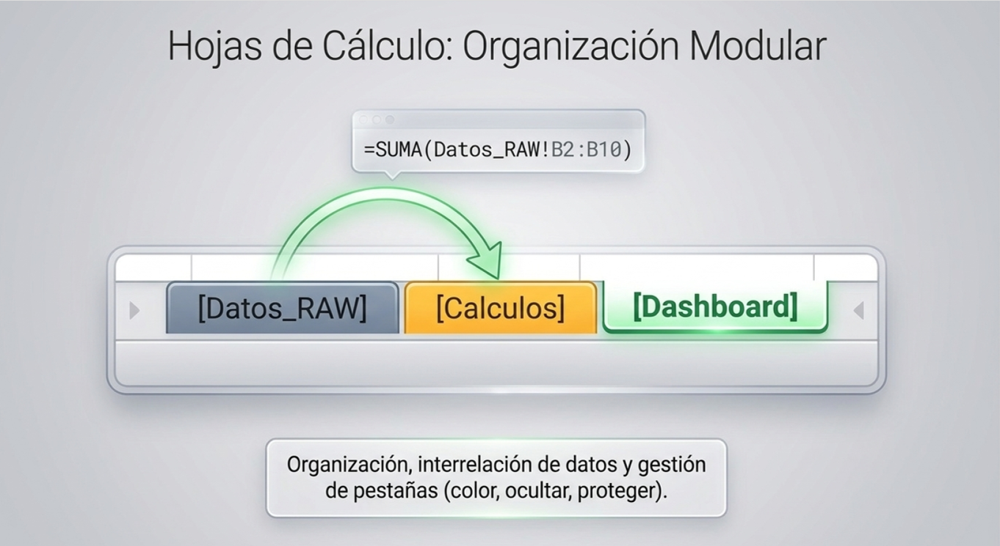
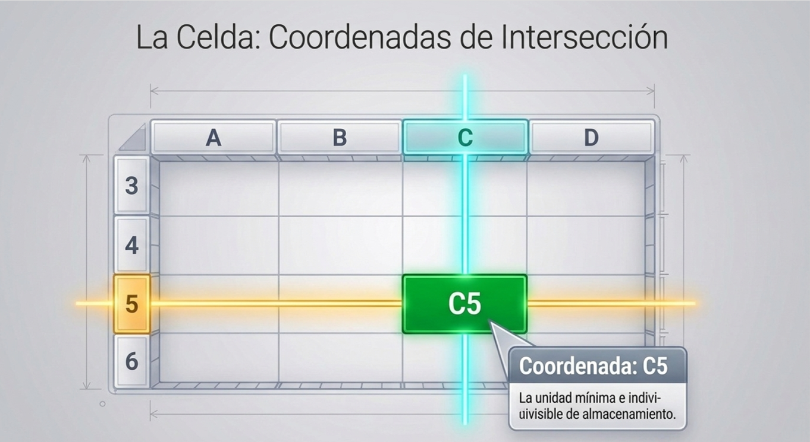
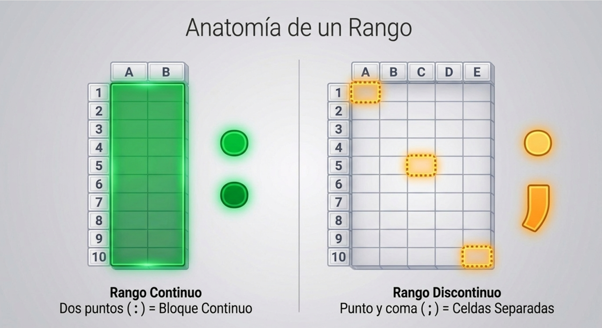
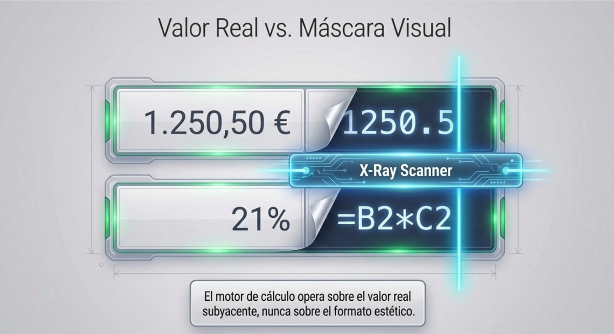
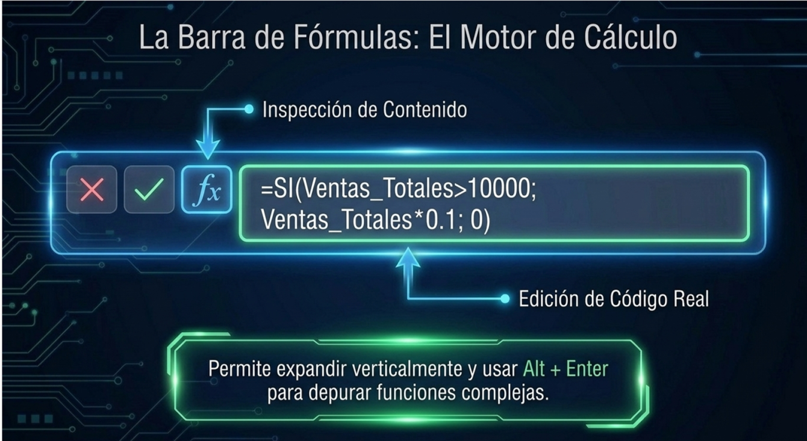

# MANUAL TEÓRICO: CONCEPTOS BÁSICOS DEL ENTORNO DE EXCEL

* **Curso:** IFCT56 Excel Avanzado y Power BI
* **Módulo:** 1 - Excel Intermedio / Fundamentos del Entorno
* **Nivel:** Iniciación / Fundamentos
* **Herramienta:** Microsoft Excel (2021 / Microsoft 365)

---

## 📑 ÍNDICE DEL MANUAL
1. [Introducción al Entorno de Trabajo de Excel](#1-introducción-al-entorno-de-trabajo-de-excel)
2. [Libros de Trabajo y Hojas de Cálculo](#2-libros-de-trabajo-y-hojas-de-cálculo)
3. [Filas, Columnas y Cuadrícula](#3-filas-columnas-y-cuadrícula)
4. [Celdas, Rangos y Tipos de Referencia](#4-celdas-rangos-y-tipos-de-referencia)
5. [El Cuadro de Nombres](#5-el-cuadro-de-nombres)
6. [La Barra de Fórmulas](#6-la-barra-de-fórmulas)
7. [Cuadro Comparativo del Entorno](#7-cuadro-comparativo-del-entorno)
8. [Buenas Prácticas y Errores Habituales](#8-buenas-prácticas-y-errores-habituales)
9. [Cuestionario de Autoevaluación y Glosario](#9-cuestionario-de-autoevaluación-y-glosario)

---

## 1. INTRODUCCIÓN AL ENTORNO DE TRABAJO DE EXCEL

En el entorno administrativo, contable y comercial de cualquier empresa, la información se gestiona principalmente mediante hojas de cálculo. Microsoft Excel es una aplicación de hoja de cálculo diseñada para organizar, analizar, calcular y representar datos numéricos y alfanuméricos dentro de un lienzo estructurado.

Para trabajar de manera ágil, sin cometer errores operativos y garantizando la trazabilidad de los datos, es imprescindible conocer la anatomía básica de su interfaz. El espacio de trabajo de Excel se compone de elementos interconectados que separan el contenedor de archivos (libros), las páginas de trabajo (hojas), la estructura matricial (filas y columnas), el punto de inserción de datos (celdas), la navegación/etiquetado (cuadro de nombres) y la capa de cálculo/edición (barra de fórmulas).

---

## 2. LIBROS DE TRABAJO Y HOJAS DE CÁLCULO

 

### 2.1. El Libro de Trabajo (*Workbook*)
El **Libro de trabajo** es el archivo completo generado en Excel. Constituye el contenedor principal de información y se almacena en el disco duro con extensiones de archivo específicas según sus características:
* **`.xlsx`:** Formato estándar de libro de cálculo de Excel (sin macros activas).
* **`.xlsm`:** Libro habilitado para macros y código ejecutable en VBA (*Visual Basic for Applications*).
* **`.xltx`:** Plantilla de Excel reutilizable que actúa como modelo base en blanco.

Un libro de trabajo puede albergar una o múltiples hojas de cálculo interconectadas, permitiendo consolidar el flujo completo de un proyecto en un único documento.

### 2.2. Las Hojas de Cálculo (*Worksheets*)
Una **Hoja de cálculo** es cada una de las pestañas o páginas individuales ubicadas en la barra inferior del libro de trabajo.
* **Organización modular:** Permiten separar diferentes áreas o etapas del análisis (por ejemplo: `Hoja1_Datos_RAW`, `Hoja2_Calculos`, `Hoja3_Dashboard`).
* **Interrelación de datos:** Se pueden enlazar fórmulas entre distintas hojas de un mismo libro (ejemplo: `=SUMA(Ventas!B2:B10)`) e incluso relacionar datos pertenecientes a libros de trabajo independientes.
* **Gestión de pestañas:** Haciendo clic derecho sobre la etiqueta de cualquier hoja se pueden cambiar sus nombres por etiquetas de negocio descriptivas, asignar colores de pestaña, insertar nuevas hojas, duplicarlas u ocultarlas para proteger la estructura del informe.

    

---

## 3. FILAS, COLUMNAS Y CUADRÍCULA

El área de trabajo de una hoja de cálculo está estructurada en forma de matriz o cuadrícula bidimensional delimitada por líneas de guía verticales y horizontales.

### 3.1. Las Columnas (*Columns*)
* **Orientación:** Disposición vertical de datos dentro de la hoja.
* **Identificación:** Se identifican mediante **Letras** situadas en el encabezado superior del lienzo (A, B, C... Z, AA, AB... hasta la columna XFD).
* **Función en análisis de datos:** Representan las variables, atributos o campos del conjunto de datos (ejemplo: *Nombre_Cliente*, *Fecha_Factura*, *Precio_Unitario*).

### 3.2. Las Filas (*Rows*)
* **Orientación:** Disposición horizontal de datos dentro de la hoja.
* **Identificación:** Se identifican mediante **Números enteros** continuos situados en la barra de encabezados izquierda (1, 2, 3... hasta 1.048.576 filas).
* **Función en análisis de datos:** Representan las transacciones, registros o entidades individuales del conjunto de datos (ejemplo: la venta concreta número 101 o la ficha de un empleado).

### 3.3. La Cuadrícula (*Gridlines*)
Las **líneas de cuadrícula** son los trazos finos de color gris que delimitan visualmente cada fila y columna en la pantalla. Se pueden activar o desactivar desde la pestaña **Vista > Mostrar > Líneas de cuadrícula**. Ocultar las líneas de cuadrícula es una práctica habitual de maquetación para presentar cuadros de mando (*dashboards*) limpios sobre un lienzo blanco.

---

## 4. CELDAS, RANGOS Y TIPOS DE REFERENCIA

### 4.1. La Celda (*Cell*)
La **Celda** es la intersección exacta entre una columna (letra) y una fila (número). Constituye la unidad mínima e indivisible de almacenamiento de datos dentro de la hoja de cálculo.
* **Coordenada o Dirección:** Se nombra indicando primero la letra de la columna y a continuación el número de la fila (ejemplo: `A1`, `B12`, `C50`).

### 4.2. El Rango de Celdas (*Range*)
Un **Rango** es un bloque formado por un conjunto de dos o más celdas seleccionadas dentro de la hoja.
* **Rangos Continuos:** Se expresan indicando la celda superior izquierda, dos puntos (`:`) y la celda inferior derecha (ejemplo: `A1:B10`, que abarca todas las celdas comprendidas entre las columnas A y B de las filas 1 a 10).
* **Rangos Discontinuos:** Celdas o bloques separados mediante punto y coma `;` (ejemplo: `A1;C5;E10`).

    

### 4.3. Valor Almacenado vs. Formato Visual
Uno de los conceptos más importantes en Excel es la diferencia entre el dato que la celda guarda internamente y cómo se muestra en pantalla:
* **Valor real o subyacente:** Es el número, texto o fórmula pura almacenada en la celda (ejemplo: `1250.5` o `=B2*C2`).
* **Formato visual (Mascara estética):** Es la capa estética aplicada sobre la celda que altera su apariencia sin modificar el dato interno (ejemplo: mostrar `1.250,50 €` o `125050%`). El motor de cálculo de Excel opera siempre sobre el valor real, no sobre la máscara visual.

    

### 4.4. Referencias Relativas y Absolutas
Al construir fórmulas en celdas, el modo de referenciar las coordenadas determina su comportamiento al copiar o arrastrar el controlador de relleno:
* **Referencia Relativa (`A1`):** Cambia y se adapta automáticamente a la nueva posición cuando la fórmula se copia a otra celda.
* **Referencia Absoluta (`$A$1`):** Mantiene fijos la fila y la columna mediante el signo del dólar (`$`), impidiendo que las coordenadas varíen sin importar adónde se copie o estire la fórmula.

    

---

## 5. EL CUADRO DE NOMBRES

### 5.1. Ubicación y Definición
El **Cuadro de Nombres** es una casilla rectangular de texto ubicada en la parte superior izquierda de la hoja de cálculo, inmediatamente a la izquierda de la barra de fórmulas y por encima de la columna A.

### 5.2. Funciones Principales del Cuadro de Nombres
1. **Identificador de Celda Activa:** Muestra en todo momento la coordenada exacta de la celda donde se encuentra situado el cursor (ejemplo: `B2`). Si se selecciona un rango de celdas, muestra la celda desde la que comenzó la selección.
2. **Navegación Rápida:** Permite escribir directamente una coordenada (ejemplo: `XFD1000`) y presionar **Enter** para desplazar el foco de la pantalla instantáneamente hacia esa posición sin usar las barras de desplazamiento.
3. **Creación de Nombres de Rangos:** Permite asignar etiquetas personalizadas a celdas individuales o rangos (ejemplo: etiquetar la celda `L2` con el nombre `Tipo_IVA` o el rango `C2:C50` con el nombre `Sueldo_Base`).
4. **Desplegable de Nombres Definidos:** Al hacer clic en la flecha pequeña del Cuadro de Nombres, se despliega la lista con todos los nombres de rango creados en el libro. Seleccionar uno de la lista selecciona automáticamente ese rango en la hoja.

---

## 6. LA BARRA DE FÓRMULAS

### 6.1. Ubicación y Definición
La **Barra de Fórmulas** es la franja horizontal situada en la parte superior del lienzo, ubicada entre el Cuadro de Nombres (a la izquierda) y la cuadrícula de trabajo (en la parte inferior). Está encabezada por los botones de edición `✓` (Aceptar), `X` (Cancelar) e `fx` (Insertar función).

### 6.2. Funciones Técnicas de la Barra de Fórmulas
1. **Inspección de Contenido Real:** Muestra el contenido verdadero almacenado en la celda activa. Si una celda muestra visualmente el resultado `1.210,00 €`, la barra de fórmulas revelará la fórmula subyacente que lo genera (ejemplo: `=B2*(1+Tipo_IVA)`).
2. **Edición y Depuración de Código:** Permite escribir, corregir y auditar fórmulas, funciones y expresiones lógicas complejas con comodidad.
3. **Edición Multilínea (`Alt + Enter`):** Permite expandir la barra verticalmente e introducir saltos de línea manuales presionando `Alt + Enter` para separar los argumentos de una fórmula extensa en varias líneas, mejorando su lectura y mantenimiento.

---

## 7. CUADRO COMPARATIVO DEL ENTORNO

---

## 8. BUENAS PRÁCTICAS Y ERRORES HABITUALES

### 8.1. Buenas Prácticas
* **Nombrar las hojas del libro inmediatamente:** Reemplazar los nombres por defecto (`Hoja1`, `Hoja2`) por nombres representativos en mayúsculas/minúsculas limpios (ejemplo: `Datos_Ventas`, `Parametros`).
* **Nombres de rangos limpios:** Al asignar nombres desde el Cuadro de Nombres, utilizar el formato `Tipo_Concepto` sin espacios ni caracteres especiales (ejemplo: `Tipo_IVA`, `Limite_Alto`).
* **Usar la Barra de Fórmulas para depurar:** Acostumbrarse a revisar siempre la barra de fórmulas para verificar si un dato es un valor fijo o el resultado de una fórmula antes de sobreescribirlo.
* **Aislado de parámetros:** Colocar los tipos de interés, IVA o límites en celdas individuales nombradas y hacer referencia a ellas mediante sus nombres en la barra de fórmulas.

### 8.2. Errores Habituales
* **Confundir el formato con el valor almacenado:** Ocultar decimales con la barra de formato y pensar que Excel ha redondeado el número internamente para los cálculos posteriores.
* **Intentar crear nombres de rango con espacios en el Cuadro de Nombres:** Escribir `Ventas Totales` en el Cuadro de Nombres provoca un error de sintaxis en Excel. Usar en su lugar `Ventas_Totales`.
* **Mezclar filas/columnas en blanco dentro de la cuadrícula:** Dejar filas totalmente vacías en medio de un listado de datos rompe la detección automática de rangos para tablas dinámicas y fórmulas globales.
