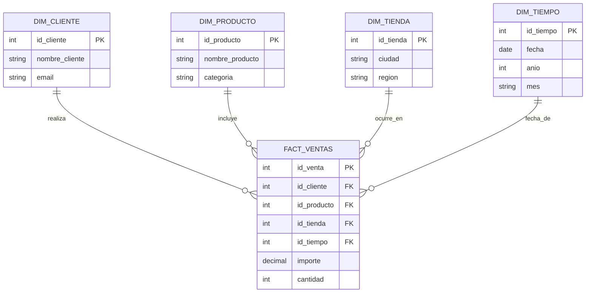

# 🗄️ MODELADO DE DATOS DIMENSIONAL Y FUNDAMENTOS DE RELACIONES

## 1. INTRODUCCIÓN AL MODELADO DE DATOS DIMENSIONAL

### 1.1. ¿Qué es el modelado de datos dimensional?
El **modelado de datos dimensional** es una técnica de diseño de bases de datos específicamente optimizada para el análisis de grandes volúmenes de información y la toma de decisiones empresariales. 

A diferencia de los sistemas transaccionales tradicionales (OLTP), cuyo objetivo es registrar operaciones individuales rápidamente (como cobrar un artículo en caja), el modelado dimensional organiza la información de forma lógica y estructurada para que las preguntas complejas de negocio se respondan en cuestión de segundos.

En el análisis de datos moderno en Power BI Desktop, este modelo permite transformar datos brutos en una estructura limpia, rápida y comprensible para el usuario final.

### 1.2. El problema de las Tablas Planas (Archivos Planos)
En el entorno tradicional de hojas de cálculo como Excel, la información suele estructurarse en **tablas planas** o monolíticas. En una tabla plana, toda la información de las ventas, los clientes, los productos y las fechas se almacena en una única pestaña gigante.

Trabajar con tablas planas presenta graves inconvenientes en el ámbito profesional:
* **Redundancia masiva de datos:** La información descriptiva (como el nombre de un cliente, su correo o la categoría y proveedor de un producto) se repite innecesariamente en miles de filas, aumentando de forma absurda el tamaño del archivo.

* **Riesgo de inconsistencia y erratas:** Si el nombre de un producto cambia o se corrige un error tipográfico, es necesario modificar miles de registros individuales fila por fila. Si se omite una sola fila, los datos pierden coherencia.

* **Rendimiento deficiente:** Los cálculos de fórmulas condicionales y resúmenes sobre tablas gigantescas consumen una cantidad excesiva de memoria, ralentizan la carga de los informes y dificultan la legibilidad.

El modelado dimensional resuelve estas deficiencias dividiendo la información en tablas especializadas conectadas de forma inteligente mediante relaciones lógicas.

---

## 2. FUNDAMENTOS DE BASES DE DATOS RELACIONALES: EL CATÁLOGO DE CLAVES

Una **base de datos relacional** es una colección de tablas organizadas lógicamente que se conectan entre sí mediante columnas de valores comunes. Para establecer estas conexiones de forma segura, el motor relacional de Power BI se apoya en el concepto de **claves** (*keys*).

A continuación se detalla el catálogo completo de claves técnicas utilizadas en el diseño y administración de bases de datos relacionales:

```
┌────────────────────────────────────────────────────────────────────────┐
│                          CLAVE CANDIDATA                               │
│  (Cualquier columna o grupo de columnas que identifica de forma única) │
│                                                                        │
│        ┌───────────────────────────┐   ┌───────────────────────────┐   │
│        │      CLAVE PRIMARIA       │   │     CLAVE ALTERNATIVA     │   │
│        │ (Elegida como principal)  │   │  (No elegida como PK)     │   │
│        └─────────────┬─────────────┘   └───────────────────────────┘   │
└──────────────────────┼─────────────────────────────────────────────────┘
                       │
                       │ Relación (1:N)
                       ▼
         ┌───────────────────────────┐
         │       CLAVE FORÁNEA       │
         │ (Apunta a la PK en hechos)│
         └───────────────────────────┘
```

### 2.1. Clave Candidata (Candidate Key)
Una **clave candidata** es cualquier columna (o conjunto mínimo de columnas) que cumple con la condición de identificar de forma única e inequívoca cada uno de los registros (filas) de una tabla.

* **Propiedades obligatorias:** Debe contener valores únicos (no repetidos) y no puede contener valores nulos (NULL). Además, debe ser irreductible, es decir, no debe tener columnas sobrantes que no aporten a la unicidad.
  * *Ejemplo:* En una tabla de `Empleados`, tanto el `DNI`, el `Correo_Corporativo` como el `Codigo_Empleado` son, por separado, claves candidatas, ya que ninguna de ellas se repetirá jamás entre distintos trabajadores.

### 2.2. Clave Primaria (Primary Key - PK)
La **clave primaria** es la clave candidata elegida por el diseñador o administrador de la base de datos para identificar de manera principal y oficial cada registro de una tabla.
* **Propiedades obligatorias:** Es estrictamente obligatoria (solo puede haber una clave primaria por tabla), sus valores deben ser únicos (no repetidos) y jamás admite valores nulos (NULL) [79, 86].
  * *Ejemplo:* En nuestra dimensión de productos (`DIM_PRODUCTO`), el campo `ID_Producto` es la Clave Primaria (PK) [81, 82]. Identifica de forma exclusiva cada artículo del catálogo.

### 2.3. Clave Alternativa (Alternative Key / Secondary Key)
La **clave alternativa** es cualquier clave candidata que, tras el proceso de diseño, no fue seleccionada como la clave primaria de la tabla.
* **Propiedades obligatorias:** Mantiene las mismas propiedades de unicidad que la clave primaria, pero no actúa como el enlace principal en las relaciones de la base de datos.
  * *Ejemplo:* Si en la tabla de `Empleados` seleccionamos el `Codigo_Empleado` como la Clave Primaria, los campos `DNI` y `Correo_Corporativo` pasan a ser Claves Alternativas.

### 2.4. Clave Foránea o Ajena (Foreign Key - FK)
La **clave foránea** es una columna (o conjunto de columnas) en una tabla secundaria que hace referencia directa a la clave primaria (PK) de otra tabla principal para establecer una conexión relacional entre ambas.
* **Propiedades obligatorias:** A diferencia de la Clave Primaria, la clave foránea **sí permite valores repetidos** en su tabla. Es la columna que recibe el flujo de datos y propaga los filtros.
  * *Ejemplo:* En la tabla central de ventas (`FACT_VENTAS`), el campo `ID_Producto` actúa como Clave Foránea (FK). Un mismo producto puede venderse muchas veces al día, por lo que su código aparecerá repetido en las transacciones de venta, pero cada una de esas filas apuntará de forma exacta a la ficha única de la tabla de productos.

### 2.5. Clave Compuesta (Composite Key / Compound Key)
Una **clave compuesta** es una clave primaria o foránea que está conformada por la unión de **dos o más columnas** de la tabla para poder garantizar la unicidad de cada fila.
* **Uso en Power BI:** Aunque las bases de datos relacionales tradicionales utilizan claves compuestas con frecuencia, **Power BI Desktop no admite relaciones basadas en múltiples columnas de forma nativa**. Para relacionar tablas por más de un campo, se debe concatenar previamente dichas columnas en Power Query para crear una única clave simple de tipo texto (ejemplo: `CodCliente & "-" & CodSede`), o recurrir a modelos avanzados.

### 2.6. Clave Natural (Natural Key) vs. Clave Subrogada o Artificial (Surrogate Key)
* **Clave Natural:** Es un identificador único que ya existe en el mundo real y posee un significado de negocio directo (por ejemplo, el número de DNI de una persona, el código de barras de un producto o el número de bastidor de un vehículo).

* **Clave Subrogada:** Es un valor numérico entero (habitualmente secuencial e autoincremental, como 1, 2, 3...) generado artificialmente en la base de datos con el único propósito de actuar como clave primaria. No tiene significado de negocio ni utilidad para el usuario final, pero es altamente recomendable en Power BI porque optimiza enormemente el rendimiento y reduce drásticamente el tamaño del modelo de datos al sustituir claves de texto largas por números enteros ágiles.

---

## 3. CARDINALIDAD DE LAS RELACIONES

La **cardinalidad** es el tipo de relación técnica que se establece entre dos tablas conectadas, indicando cómo se relacionan numéricamente los registros de una tabla con los de la otra.

En Power BI Desktop, al trazar relaciones en la Vista de Modelo, podemos encontrarnos con tres tipos de cardinalidad:

### 3.1. Relación de Uno a Varios (1:N o 1:*) — *El Estándar de Oro*
Es la relación recomendada por defecto en el modelado dimensional. En ella, un registro de la Tabla A (dimensión) se relaciona con múltiples registros de la Tabla B (hechos), pero un registro de la Tabla B solo apunta a un único registro de la Tabla A.
* *Ejemplo:* Un cliente único (`1` en la dimensión de clientes) puede realizar muchas compras (`*` en la tabla de hechos de ventas) a lo largo del año. Sin embargo, cada ticket de venta específico pertenece a un único cliente.

### 3.2. Relación de Uno a Uno (1:1)
Ocurre cuando un registro de la Tabla A se relaciona de forma exclusiva con un único registro de la Tabla B. 
* *Uso práctico:* Es poco común en modelado dimensional. Si dos tablas tienen una relación 1:1, la buena práctica suele ser fusionarlas en una única tabla mediante Power Query para simplificar el modelo y acelerar los cálculos de las fórmulas.

### 3.3. Relación de Varios a Varios (M:N o * : *)
Ocurre cuando múltiples registros de la Tabla A se conectan con múltiples registros de la Tabla B.
* *Riesgos:* Genera graves ambigüedades en los cálculos, ralentiza la velocidad de carga de los informes y suele ser un síntoma inequívoco de una falta de limpieza previa de datos en Power Query (presencia de duplicados accidentales en las dimensiones). **Deben evitarse en la medida de lo posible**.

---

## 4. EL ESQUEMA EN ESTRELLA

El **esquema en estrella** es la arquitectura de diseño relacional estándar de oro en Business Intelligence. Recibe su nombre porque, al dibujar el modelo en la interfaz visual, la tabla principal se sitúa en el centro y las tablas de apoyo se distribuyen a su alrededor como las puntas de una estrella.




El esquema en estrella consta estrictamente de dos tipos de tablas especializadas:

### 4.1. La Tabla de Hechos (Fact Table)
Es la tabla central del modelo analítico. Almacena las **métricas cuantitativas y numéricas** que miden las transacciones del negocio.

**Características principales:**
  * Sus filas crecen de forma constante con cada transacción operativa (pueden albergar millones de registros).
  
  * Contiene las columnas numéricas con las que realizamos cálculos matemáticos (importes, cantidades, costes, tiempos).
  
  * Contiene las **claves foráneas (FK)** necesarias para enlazar cada transacción con su contexto descriptivo.
  > *Ejemplo de tabla de hechos:* `FACT_VENTAS`, `FACT_EMBARQUES`, `FACT_PRESUPUESTOS`.

### 4.2. Las Tablas de Dimensiones (Dimension Table)
Son las tablas que rodean a la tabla de hechos. Almacenan el **contexto descriptivo y cualitativo** del negocio, es decir, el *quién*, *qué*, *dónde* y *cuándo* de las transacciones.

**Características principales:**
  * Contienen columnas de texto con atributos legibles para ordenar, agrupar y filtrar (nombres de clientes, categorías de productos, marcas, provincias, meses, años).
  * Son tablas considerablemente más cortas y estables que la de hechos (sus filas solo aumentan cuando se da de alta un elemento en el maestro de la empresa, como un nuevo empleado o producto).
  * Contienen la **clave primaria (PK)** que garantiza la unicidad de cada elemento maestro.
  > *Ejemplos de tablas de dimensiones:* `DIM_PRODUCTOS`, `DIM_CLIENTES`, `DIM_EMPLEADOS`, `DIM_TIEMPO` (Tabla de fechas dedicada).

> **Analogía: El Supermercado Organizado**
>
> Para comprender de forma sencilla la diferencia operativa entre ambos enfoques, comparemos una tabla única de Excel frente a un modelo dimensional:
>* **El archivo plano (Tabla única):** Es como tener todos los ingredientes, utensilios, alérgenos, distribuidores y precios escritos en un rollo de papel continuo gigante cada vez que cocinas un plato. Si cambia el precio de la harina, tienes que buscar en el rollo de papel y tachar a mano el precio en cada línea donde se usó la harina, provocando errores.
>
>* **El modelo dimensional (Esquema en estrella):** Es como un supermercado perfectamente organizado. 
> * En el centro está el **ticket de la caja registradora** (tabla de hechos) que anota de forma ultrarrápida qué códigos de barra se compraron, en qué cantidad y a qué hora. 
>  * En los pasillos de alrededor (tablas de dimensiones) están las **etiquetas fijas** con la información técnica de los productos, los datos del cliente y los cajeros. 
>  * Si un producto cambia de nombre o proveedor, sólo se actualiza una vez en su etiqueta de pasillo, y automáticamente se refleja en todas las ventas del ticket de caja sin tocar nada más.

---

## 5. PROCEDIMIENTO TÉCNICO EN POWER BI DESKTOP

Para implementar con rigor un modelo en estrella, se debe seguir secuencialmente el siguiente protocolo en **Power BI Desktop**:

1. **Importar las fuentes:** Carga las tablas de hechos y de dimensiones desde tu origen de datos (por ejemplo, tu libro Excel maquetado con tablas estructuradas) pulsando en *Inicio > Obtener datos*.

2. **Revisar en Power Query:** Accede al editor de Power Query, verifica que los tipos de datos de las columnas clave sean homogéneos (enteros para códigos numéricos, texto para códigos alfanuméricos) y, sobre todo, asegúrate de que no existan duplicados en las columnas clave de tus dimensiones aplicando *Quitar duplicados*. Haz clic en *Cerrar y aplicar*.

3. **Acceder a la Vista de Modelo:** Haz clic en el icono **Vista de modelo** en el menú de navegación del lateral izquierdo de Power BI Desktop (representado por un icono de tres rectángulos conectados).

4. **Trazar la relación (Drag and Drop):** Haz clic sobre el campo que actúa como Clave Primaria (PK) en la tabla de dimensión (ejemplo: `ID_Producto` en la tabla `Productos`), arrástralo y suéltalo directamente sobre el campo de Clave Foránea (FK) de la tabla de hechos (ejemplo: `ID_Producto` en `Ventas`).

5. **Verificar la relación:** Comprueba visualmente que la línea de conexión dibuje un **1** en el extremo de la dimensión y un asterisco en el extremo de la tabla de hechos, confirmando la cardinalidad de **Uno a Varios (1:*)**.

6. **Configurar la dirección del filtro cruzado:** Haz doble clic sobre la línea de relación para abrir la configuración avanzada. Asegúrate de que la dirección del filtro cruzado esté establecida en **Única** y que la flecha apunte desde la dimensión hacia la tabla de hechos. Esto garantiza que los filtros aplicados en tus dimensiones se propaguen hacia las métricas de transacciones, protegiendo el rendimiento y evitando dependencias circulares.

---

## 6. BUENAS PRÁCTICAS Y ERRORES HABITUALES EN MODELADO

### 6.1. Buenas Prácticas Profesionales (UX/UI y Rendimiento)

* **Ocultar claves técnicas de control:** En la pestaña de campos de Power BI Desktop, haz clic derecho sobre todas las columnas de claves primarias y foráneas de la tabla de hechos y selecciona **Ocultar en vista de informe**. Los usuarios finales nunca deben interactuar con identificadores numéricos técnicos áridos; solo deben construir gráficos arrastrando los campos descriptivos y legibles de las dimensiones.

* **Crear siempre una Tabla de Fechas dedicada (Dim_Tiempo):** Power BI genera de forma predeterminada jerarquías de fechas automáticas que consumen mucha memoria y limitan los análisis lógicos. La buena práctica profesional exige desactivar las fechas automáticas en la configuración global y crear una dimensión de calendario independiente (`Dim_Tiempo` o `Calendario`) para poder ejecutar fórmulas de Inteligencia de Tiempo avanzadas en DAX.

* **Utilizar nomenclaturas legibles de negocio:** Renombra tus campos y tablas utilizando etiquetas claras y comprensibles para el negocio (ejemplo: usar `DIM_PRODUCTOS` en lugar de `tbl_fct_prd_01_bruto`). Los informes de inteligencia de negocio están diseñados para ser compartidos y auditados por otras áreas de la empresa.

* **Mantener un esquema en estrella puro:** Evita el anidamiento sucesivo de tablas descriptivas (por ejemplo, relacionar una tabla de países a una de provincias, y esta a una de clientes, lo que se conoce como *esquema en copo de nieve*), ya que ralentiza innecesariamente las consultas del motor relacional.

### 6.2. Errores Habituales y Soluciones Técnicas

* **Aparición de relaciones de Muchos a Muchos accidentales:**
    
    * *Causa:* Se intenta relacionar una dimensión con los hechos, pero Power BI fuerza una relación de muchos a muchos. Esto ocurre porque la columna de la clave primaria en la tabla de dimensiones contiene registros duplicados o celdas vacías (fallo de calidad en el origen).
    
    * *Solución:* No aceptes la relación de muchos a muchos. Cancela la operación, regresa al Editor de Power Query, selecciona la columna de la clave de la dimensión, haz clic en *Quitar duplicados* y vuelve a aplicar los cambios. Al recargar, la relación se establecerá limpiamente como Uno a Varios (1:*).

* **Mantener tablas anchas (monolíticas):**
    
    * *Causa:* Intentar importar una única tabla de Excel con decenas de columnas y realizar todo el dashboard sobre ella por comodidad.
    
    * *Consecuencia:* El archivo se vuelve extremadamente pesado, las fórmulas DAX se vuelven largas y complejas, y el cuadro de mando pierde interactividad y velocidad. Desaprovecha la arquitectura relacional.
    
    * *Solución:* Utiliza las capacidades de Power Query para desgranar y separar las dimensiones de los hechos, creando una estrella limpia.
