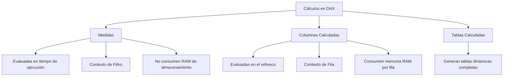
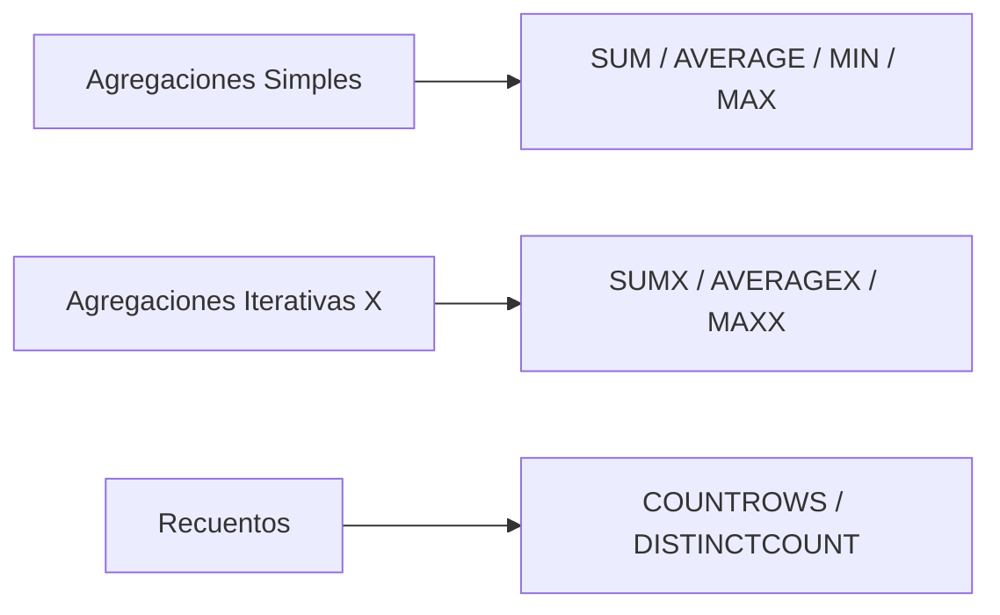

# DAX Y MODELADO ANALÍTICO EN POWER BI

---

## 1. INTRODUCCIÓN Y DEFINICIÓN DE DAX

### 1.1. ¿Qué es DAX?
**DAX** (*Data Analysis Expressions* o Expresiones de Análisis de Datos) es la biblioteca de funciones, operadores y sintaxis utilizada para crear cálculos, agregaciones y modelos de datos en **Microsoft Power BI**, **Power Pivot en Excel** y **Microsoft Analysis Services (Tabular)**.

A diferencia del lenguaje de fórmulas tradicional de Excel —que está diseñado para operar sobre celdas individuales o rangos bidimensionales fijados en una cuadrícula (`A1`, `B2:B10`)—, **DAX es un lenguaje relacional y orientado a tablas**. Trabaja directamente sobre **modelos semánticos** formados por tablas de hechos y dimensiones interconectadas mediante relaciones.

```
[ Excel Tradicional ]    ──> Opera sobre Celdas y Rangos fijos (A1, $B$2)
[ Power BI / DAX ]       ──> Opera sobre Tablas Relacionales y Filtros Dinámicos
```

### 1.2. El Motor Tabular (VertiPaq)
DAX no procesa los datos fila a fila en el disco duro; se ejecuta sobre el motor en memoria **VertiPaq (Engine Tabular)**. Este motor comprime y almacena la información en columnas (almacenamiento columnar), lo que le permite analizar y agregar millones de registros en milisegundos. 

Para que DAX funcione con la máxima velocidad y sencillez, requiere que los datos estén organizados en un **esquema en estrella**, donde las tablas de dimensiones filtran a la tabla central de hechos.

### 1.3. La IA como Copiloto (Copilot) y la Importancia de la Teoría
En el entorno empresarial moderno, herramientas de Inteligencia Artificial como **Microsoft Copilot** permiten redactar expresiones DAX a partir de instrucciones en lenguaje natural (ejemplo: *"Calcula las ventas acumuladas del año actual comparadas con el año anterior"*).

Sin embargo, **la IA actúa como un copiloto, no como el piloto**:
* **Copilot** genera la sintaxis y propone la estructura de la fórmula.
* **El Analista de Datos (Tú)** debe comprender los **contextos de evaluación** para determinar si el resultado mostrado en la pantalla es matemáticamente correcto, diagnosticar filtrados cruzados inesperados y garantizar que la lógica de negocio se cumple al 100%.

---

## 2. CONCEPTOS FUNDAMENTALES Y ARQUITECTURA DE DAX

Para dominar DAX es imprescindible distinguir los tres tipos de objetos de cálculo que se pueden crear en Power BI y comprender cómo se evalúan.



### 2.1. Tipos de Cálculos en DAX

#### 1. Medidas (Measures)
Son fórmulas de cálculo dinámico que se evalúan **en tiempo de ejecución**, exactamente en el momento en que el usuario interactúa con un informe (al pulsar un segmentador, filtrar una fecha o hacer clic en una barra de un gráfico).
* **Almacenamiento:** No consumen espacio en el disco ni memoria RAM para almacenar datos fila por fila. Solo guardan la definición de la fórmula.
* **Comportamiento:** Su resultado cambia automáticamente según las visualizaciones y filtros activos en la pantalla.
* **Uso recomendado:** El 90% de los cálculos de un informe (totales, promedios, ratios, variaciones interanuales) deben ser **medidas**.

#### 2. Columnas Calculadas (Calculated Columns)
Son columnas adicionales que se añaden a una tabla existente del modelo mediante una expresión DAX.
* **Almacenamiento:** Se evalúan durante la carga o **refresco del modelo** y sus valores se almacenan de forma permanente fila a fila en la memoria RAM y en el archivo `.pbix`.
* **Comportamiento:** Tienen un valor estático por cada fila de la tabla.
* **Uso recomendado:** Únicamente cuando se necesite utilizar el resultado como un **segmentador de datos (Slicer)**, una leyenda de gráfico o una categoría de fila/columna. Evitar para cálculos agregados.

#### 3. Tablas Calculadas (Calculated Tables)
Son tablas enteras creadas a partir de una expresión DAX que devuelve una matriz de datos (por ejemplo, al generar una tabla de calendario dedicada con `CALENDAR` o `CALENDARAUTO`).

---

### 2.2. Los Contextos de Evaluación (El Corazón de DAX)

El secreto para dominar DAX reside en entender sus dos contextos de evaluación:

#### 1. Contexto de Fila (Row Context)
Es la capacidad de DAX de saber en qué fila específica de una tabla se encuentra situado durante un cálculo.
* Existe de forma automática en las **columnas calculadas** y en las funciones iterativas (como `SUMX`, `AVERAGEX`).
* *Ejemplo:* En una columna calculada `[Importe] = 'Ventas'[Cantidad] * 'Ventas'[Precio]`, el contexto de fila asegura que para la fila 5 se multiplique la cantidad de la fila 5 por el precio de la fila 5.

#### 2. Contexto de Filtro (Filter Context)
Es el conjunto de restricciones o filtros activos que afectan a un cálculo en un instante dado. Se compone de:
1. Los filtros aplicados en los **segmentadores de datos (Slicers)** de la página.
2. Los elementos seleccionados en **otros gráficos** del informe (filtro cruzado).
3. Las filas o columnas de la **tabla/matriz** donde está ubicada la medida.
4. Los filtros introducidos explícitamente dentro de la fórmula mediante la función `CALCULATE`.

#### 3. Transición de Contexto (Context Transition)
Es el proceso mediante el cual un **contexto de fila se transforma automáticamente en un contexto de filtro equivalente**.
* Se activa siempre que se invoca la función `CALCULATE` o cuando se llama a una **Medida** dentro de un contexto de fila (por ejemplo, dentro de una columna calculada o una función iterativa como `SUMX`).

---

## 3. SINTAXIS, OPERADORES Y BUENAS PRÁCTICAS

### 3.1. Sintaxis Estándar
Una expresión DAX sigue una estructura rígida para garantizar la trazabilidad de los datos:

$$\text{Nombre\_Medida} = \text{NOMBRE\_FUNCIÓN}(\text{'Nombre\_Tabla'}[Nombre\_Columna])$$

```dax
Ventas_Totales = SUM('FACT_Ventas'[Importe])
```

* **Nombre de la Medida:** Va seguido del operador de asignación `=`.
* **Nombre de la Tabla:** Entre comillas simples `'FACT_Ventas'`. Obligatorio al hacer referencia a columnas.
* **Nombre de la Columna:** Entre corchetes `[Importe]`.
* **Invocación de Medidas:** Cuando una fórmula hace referencia a otra medida existente, se escribe directamente entre corchetes sin incluir la tabla: `[Ventas_Totales] * 0.21`.

### 3.2. Operadores en DAX

| Tipo | Operador | Descripción | Ejemplo |
| :--- | :---: | :--- | :--- |
| **Aritméticos** | `+`, `-`, `*`, `/` | Suma, resta, multiplicación, división | `[Ventas] - [Costes]` |
| | `^` | Potenciación | `'Tabla'[Base] ^ 2` |
| **Comparación** | `=`, `<>`, `>`, `<` | Igual, distinto, mayor que, menor que | `'Cliente'[Edad] >= 18` |
| | `>=`, `<=` | Mayor/igual, menor/igual | |
| **Concatenación**| `&` | Une dos cadenas de texto | `'Cliente'[Nombre] & " " & 'Cliente'[Apellido]` |
| **Lógicos** | `&&` | Operador **Y** (AND) | `[Edad] >= 18 && [Edad] <= 65` |
| | `\|\|` | Operador **O** (OR) | `[Estado] = "Madrid" \|\| [Estado] = "Barcelona"` |
| | `IN` | Compara contra una lista entre llaves | `'Ventas'[Zona] IN {"Norte", "Sur"}` |

---

### 3.3. Buenas Prácticas Profesionales de Código

1. **La Regla de Oro del Nombre de Tabla:**
   * Al referenciar una **columna**, incluye siempre el nombre de la tabla: `'FACT_Ventas'[Importe]`.
   * Al referenciar una **medida**, escribe solo el nombre de la medida entre corchetes: `[Ventas_Totales]`. Esto permite distinguir de un vistazo qué es una columna y qué es una medida.
2. **Evitar la división tradicional `/`:** Usar siempre la función `DIVIDE(Numerador, Denominador, [ValorSiError])`. Previene errores de división por cero (`#DIV/0!`) y optimiza el rendimiento.
3. **Crear una Tabla de Medidas Dedicada:** Crear una tabla vacía (ejemplo: `_Medidas`) para almacenar todas las medidas del modelo de forma organizada en un solo lugar.
4. **Formatear el código con sangrías:** Dividir las fórmulas complejas en varias líneas utilizando `Shift + Enter` e indenciones para facilitar su auditoría.

---

## 4. CATÁLOGO COMPLETO DE FUNCIONES DAX POR CATEGORÍA

A continuación se presentan las **10 categorías principales de funciones DAX**, detallando las herramientas más utilizadas en entornos profesionales, su sintaxis, descripción y casos de uso real.

---

### 4.1. Funciones de Agregación (Aggregation Functions)
Evalúan un conjunto de valores en una columna y devuelven un único valor escalar numérico.



#### 1. SUM
* **Sintaxis:** `SUM('Tabla'[Columna])`
* **Descripción:** Suma todos los números de una columna.
* **Ejemplo:** `Total_Ingresos = SUM('FACT_Ventas'[Importe])`

#### 2. AVERAGE
* **Sintaxis:** `AVERAGE('Tabla'[Columna])`
* **Descripción:** Calcula la media aritmética de una columna numérica.
* **Ejemplo:** `Ticket_Medio = AVERAGE('FACT_Ventas'[Importe])`

#### 3. MIN / MAX
* **Sintaxis:** `MIN('Tabla'[Columna])` / `MAX('Tabla'[Columna])`
* **Descripción:** Devuelve el valor mínimo o máximo de una columna (funciona con números, fechas y texto).
* **Ejemplo:** `Ultima_Fecha_Venta = MAX('FACT_Ventas'[Fecha])`

#### 4. COUNT / COUNTA / COUNTROWS
* **Sintaxis:** `COUNTROWS('Tabla')`
* **Descripción:** `COUNTROWS` cuenta el número total de filas de una tabla o resultado filtrado. Es más rápida y eficiente que `COUNT`.
* **Ejemplo:** `Total_Operaciones = COUNTROWS('FACT_Ventas')`

#### 5. DISTINCTCOUNT
* **Sintaxis:** `DISTINCTCOUNT('Tabla'[Columna])`
* **Descripción:** Cuenta el número de valores únicos no duplicados en una columna.
* **Ejemplo:** `Clientes_Unicos_Activos = DISTINCTCOUNT('FACT_Ventas'[ID_Cliente])`

#### 6. SUMX / AVERAGEX / MAXX / MINX (Funciones Iterativas "X")
* **Sintaxis:** `SUMX('Tabla', Expresión)`
* **Descripción:** Evalúa una expresión en un **contexto de fila** para cada fila de una tabla y luego suma (o promedia) los resultados obtenidos.
* **Ejemplo:** `Ventas_Netas_Total = SUMX('FACT_Ventas', 'FACT_Ventas'[Cantidad] * 'FACT_Ventas'[Precio_Unitario] * (1 - 'FACT_Ventas'[Descuento]))`

---

### 4.2. Funciones de Filtro y Contexto (Filter Functions)
Son las funciones más potentes de DAX. Permiten manipular, modificar, reemplazar o ignorar el contexto de filtro activo.

#### 1. CALCULATE (La Función Reina de DAX)
* **Sintaxis:** `CALCULATE(Expresión, [Filtro1], [Filtro2], ...)`
* **Descripción:** Evalúa una expresión en un **contexto de filtro modificado**. Permite agregar, eliminar o cambiar filtros del modelo.
* **Ejemplo:** `Ventas_Madrid = CALCULATE([Ventas_Totales], 'DIM_Cliente'[Provincia] = "Madrid")`

#### 2. FILTER
* **Sintaxis:** `FILTER('Tabla', Condición_Lógica)`
* **Descripción:** Devuelve una tabla que representa un subconjunto filtrado de otra tabla. Se utiliza habitualmente dentro de `CALCULATE` o iteradores.
* **Ejemplo:** `Ventas_Grandes_Clientes = CALCULATE([Ventas_Totales], FILTER('DIM_Cliente', 'DIM_Cliente'[Facturacion_Anual] > 100000))`

#### 3. ALL
* **Sintaxis:** `ALL('Tabla'[Columna])` o `ALL('Tabla')`
* **Descripción:** Elimina los filtros aplicados a la columna o tabla especificada. Útil para calcular porcentajes sobre el total general.
* **Ejemplo:** `Porcentaje_Cuota_Total = DIVIDE([Ventas_Totales], CALCULATE([Ventas_Totales], ALL('FACT_Ventas')))`

#### 4. ALLEXCEPT
* **Sintaxis:** `ALLEXCEPT('Tabla', 'Tabla'[Columna_Mantener1], ...)`
* **Descripción:** Elimina todos los filtros de una tabla excepto los aplicados a las columnas especificadas.
* **Ejemplo:** `Ventas_Total_Categoria = CALCULATE([Ventas_Totales], ALLEXCEPT('DIM_Producto', 'DIM_Producto'[Categoria]))`

#### 5. REMOVEFILTERS
* **Sintaxis:** `REMOVEFILTERS('Tabla'[Columna])`
* **Descripción:** Alias moderno y explícito de `ALL`, diseñado específicamente para ser usado como modificador de filtro dentro de `CALCULATE`.

#### 6. ALLSELECTED
* **Sintaxis:** `ALLSELECTED('Tabla'[Columna])`
* **Descripción:** Elimina los filtros dentro de la visualización activa pero respeta los filtros aplicados externamente mediante segmentadores de datos.

#### 7. SELECTEDVALUE
* **Sintaxis:** `SELECTEDVALUE('Tabla'[Columna], [ValorSiVarios])`
* **Descripción:** Devuelve el valor seleccionado en un segmentador o columna si solo existe un único valor activo; si hay varios, devuelve un valor alternativo o en blanco.
* **Ejemplo:** `Titulo_Dinamico = "Informe de Ventas: " & SELECTEDVALUE('DIM_Producto'[Categoria], "Todas las Categorías")`

#### 8. LOOKUPVALUE
* **Sintaxis:** `LOOKUPVALUE(Columna_Devolver, Columna_Busqueda1, Valor_Buscado1, ...)`
* **Descripción:** Busca un valor en una tabla sin necesidad de que exista una relación activa entre ambas tablas (equivalente a `BUSCARX` de Excel).

---

### 4.3. Funciones de Fecha e Inteligencia de Tiempo (Time Intelligence)
Permiten realizar comparaciones temporales complejas (acumulados anuales, comparativas interanuales, medias móviles) de forma nativa. Requieren obligatoriamente una **Tabla de Calendario/Fechas dedicada** conectada a la tabla de hechos.

#### 1. CALENDAR / CALENDARAUTO
* **Sintaxis:** `CALENDAR(Fecha_Inicio, Fecha_Fin)`
* **Descripción:** Genera una tabla calculada con una única columna de fechas consecutivas entre los límites especificados.
* **Ejemplo:** `Dim_Tiempo = CALENDAR(DATE(2025, 1, 1), DATE(2026, 12, 31))`

#### 2. TOTALYTD / TOTALQTD / TOTALMTD
* **Sintaxis:** `TOTALYTD(Expresión, 'Tabla_Fechas'[Fecha])`
* **Descripción:** Calcula el valor acumulado desde el inicio del año (YTD), trimestre (QTD) o mes (MTD) hasta la fecha actual del contexto.
* **Ejemplo:** `Ventas_Acumuladas_Año = TOTALYTD([Ventas_Totales], 'Dim_Tiempo'[Fecha])`

#### 3. SAMEPERIODLASTYEAR
* **Sintaxis:** `SAMEPERIODLASTYEAR('Tabla_Fechas'[Fecha])`
* **Descripción:** Devuelve el conjunto de fechas desplazado exactamente un año atrás en el tiempo.
* **Ejemplo:** `Ventas_Año_Anterior = CALCULATE([Ventas_Totales], SAMEPERIODLASTYEAR('Dim_Tiempo'[Fecha]))`

#### 4. DATEADD
* **Sintaxis:** `DATEADD('Tabla_Fechas'[Fecha], Número_Intervalos, Intervalo)`
* **Descripción:** Traslada un conjunto de fechas un número determinado de intervalos (`DAY`, `MONTH`, `QUARTER`, `YEAR`) hacia el futuro o el pasado.
* **Ejemplo:** `Ventas_Mes_Anterior = CALCULATE([Ventas_Totales], DATEADD('Dim_Tiempo'[Fecha], -1, MONTH))`

#### 5. DATESBETWEEN
* **Sintaxis:** `DATESBETWEEN('Tabla_Fechas'[Fecha], Fecha_Inicio, Fecha_Fin)`
* **Descripción:** Devuelve una tabla con las fechas comprendidas entre dos límites.

#### 6. DATESYTD
* **Sintaxis:** `DATESYTD('Tabla_Fechas'[Fecha])`
* **Descripción:** Devuelve un conjunto de fechas del año hasta la fecha actual para ser usado como filtro dentro de `CALCULATE`.

---

### 4.4. Funciones de Relación (Relationship Management)
Gestionan y manipulan el comportamiento de las relaciones activas e inactivas del modelo de datos.

#### 1. RELATED
* **Sintaxis:** `RELATED('Tabla_Dimension'[Columna])`
* **Descripción:** Trae el valor de una columna relacionada desde el lado "Uno" de la relación hacia el lado "Varios" (durante una columna calculada o iterador en la tabla de hechos).
* **Ejemplo:** `Costo_Linea = 'FACT_Ventas'[Cantidad] * RELATED('DIM_Producto'[Costo_Unitario])`

#### 2. RELATEDTABLE
* **Sintaxis:** `RELATEDTABLE('Tabla_Hechos')`
* **Descripción:** Evalúa la relación en sentido inverso: desde la tabla de dimensiones (lado Uno) devuelve todas las filas coincidentes de la tabla de hechos (lado Varios).

#### 3. USERELATIONSHIP
* **Sintaxis:** `USERELATIONSHIP('Tabla1'[ColumnaFK], 'Tabla2'[ColumnaPK])`
* **Descripción:** Activa temporalmente una **relación inactiva** del modelo dentro de una medida con `CALCULATE`.
* **Ejemplo:** `Ventas_Por_Fecha_Envio = CALCULATE([Ventas_Totales], USERELATIONSHIP('FACT_Ventas'[Fecha_Envio], 'Dim_Tiempo'[Fecha]))`

#### 4. CROSSFILTER
* **Sintaxis:** `CROSSFILTER('Tabla1'[FK], 'Tabla2'[PK], Dirección_Filtro)`
* **Descripción:** Modifica la dirección del filtro cruzado entre dos tablas durante la evaluación de una medida (`Both`, `Single`, `None`).

---

### 4.5. Funciones Lógicas (Logical Functions)
Evalúan condiciones lógicas y devuelven resultados basados en el cumplimiento de las reglas.

#### 1. IF
* **Sintaxis:** `IF(Prueba_Lógica, Valor_Si_Verdadero, [Valor_Si_Falso])`
* **Descripción:** Evalúa si se cumple una condición y devuelve un resultado para el caso afirmativo y otro para el negativo.
* **Ejemplo:** `Estado_Objetivo = IF([Ventas_Totales] >= 50000, "Objetivo Cumplido", "Pendiente")`

#### 2. SWITCH
* **Sintaxis:** `SWITCH(Expresión, Valor1, Resultado1, [Valor2, Resultado2], ..., [Resultado_Predeterminado])`
* **Descripción:** Reemplaza múltiples declaraciones `IF` anidadas comparando una expresión contra una lista de valores.
* **Ejemplo:** 
```dax
Semaforo_Rendimiento = 
SWITCH(
    TRUE(),
    [Ventas_Totales] >= 100000, "Verde",
    [Ventas_Totales] >= 50000, "Amarillo",
    "Rojo"
)
```

#### 3. COALESCE
* **Sintaxis:** `COALESCE(Expresión1, Expresión2, ...)`
* **Descripción:** Devuelve la primera expresión que no sea evaluada como en blanco (`BLANK`). Ideal para evitar celdas vacías en informes.
* **Ejemplo:** `Ventas_Sin_Nulos = COALESCE([Ventas_Totales], 0)`

---

### 4.6. Funciones de Manipulación de Tablas (Table Manipulation Functions)
Crean, transforman, agrupan o reestructuran tablas intermedias en memoria dentro de expresiones complejas.

#### 1. SUMMARIZE
* **Sintaxis:** `SUMMARIZE('Tabla', 'Tabla'[Columna_Grupo1], ..., ["Nombre_Campo", Expresión])`
* **Descripción:** Agrupa una tabla por las columnas especificadas y permite calcular columnas de resumen agregadas.
* **Ejemplo:** `Tabla_Resumen_Vendedores = SUMMARIZE('FACT_Ventas', 'DIM_Cliente'[Provincia], "Total", [Ventas_Totales])`

#### 2. SUMMARIZECOLUMNS
* **Sintaxis:** `SUMMARIZECOLUMNS('Tabla'[Columna1], ..., [Filtro1], ..., "Nombre", Expresión)`
* **Descripción:** La función moderna optimizada para consultas y resumen de tablas por grupos de columnas.

#### 3. ADDCOLUMNS
* **Sintaxis:** `ADDCOLUMNS('Tabla', "Nombre_Columna", Expresión)`
* **Descripción:** Añade columnas calculadas virtuales a una tabla existente mantenida en memoria.

#### 4. TOPN
* **Sintaxis:** `TOPN(N_Valor, 'Tabla', Expresión_Orden, [Orden])`
* **Descripción:** Devuelve las primeras N filas de una tabla ordenadas por una expresión especificada.
* **Ejemplo:** `Ventas_Top_5_Clientes = CALCULATE([Ventas_Totales], TOPN(5, 'DIM_Cliente', [Ventas_Totales], DESC))`

#### 5. VALUES / DISTINCT
* **Sintaxis:** `VALUES('Tabla'[Columna])`
* **Descripción:** Devuelve una tabla de una sola columna que contiene los valores únicos visibles en el contexto actual.

---

### 4.7. Funciones de Texto (Text Functions)
Manipulan, formatean y combinan cadenas de texto.

#### 1. FORMAT
* **Sintaxis:** `FORMAT(Valor, "Formato")`
* **Descripción:** Convierte un valor numérico o de fecha en texto con un formato personalizado.
* **Ejemplo:** `Fecha_Texto = FORMAT('Dim_Tiempo'[Fecha], "mmmm yyyy")`

#### 2. CONCATENATEX
* **Sintaxis:** `CONCATENATEX('Tabla', Expresión, [Delimitador])`
* **Descripción:** Itera sobre una tabla y concatena el resultado de una expresión para cada fila separándolos por un delimitador.
* **Ejemplo:** `Lista_Productos_Comprados = CONCATENATEX('DIM_Producto', 'DIM_Producto'[Nombre], ", ")`

#### 3. LEFT / RIGHT / MID / LEN / LOWER / UPPER / SUBSTITUTE
Misma sintaxis y comportamiento operativo que las funciones tradicionales de texto estudiadas en Excel.

---

### 4.8. Funciones de Información (Information Functions)
Inspeccionan el tipo de datos o el estado actual del contexto de filtro y devuelven un valor booleano (`TRUE` o `FALSE`).

#### 1. ISBLANK
* **Sintaxis:** `ISBLANK(Expresión)`
* **Descripción:** Comprueba si una expresión o celda se evalúa como en blanco.

#### 2. ISFILTERED / ISCROSSFILTERED
* **Sintaxis:** `ISFILTERED('Tabla'[Columna])`
* **Descripción:** Devuelve `TRUE` si la columna especificada está siendo filtrada directamente.

#### 3. HASONEVALUE
* **Sintaxis:** `HASONEVALUE('Tabla'[Columna])`
* **Descripción:** Devuelve `TRUE` cuando la columna se ha filtrado hasta tener un **único valor distinto** en el contexto actual.

#### 4. ISINSCOPE
* **Sintaxis:** `ISINSCOPE('Tabla'[Columna])`
* **Descripción:** Utilizada en matrices y jerarquías para comprobar si una columna es el nivel actual de desglose, permitiendo personalizar subtotales.

---

### 4.9. Funciones Matemáticas y Trigonométricas (Math & Trig Functions)

#### 1. DIVIDE (Obligatoria para Divisiones)
* **Sintaxis:** `DIVIDE(Numerador, Denominador, [ValorSiError])`
* **Descripción:** Realiza la división de forma segura. Si el denominador es cero o en blanco, devuelve el valor alternativo (o `BLANK`) en lugar de dar error.
* **Ejemplo:** `Porcentaje_Margen = DIVIDE([Beneficio_Bruto], [Ventas_Totales], 0)`

#### 2. ABS / ROUND / ROUNDUP / ROUNDDOWN / INT / MOD
* **Descripción:** Mismo comportamiento matemático de redondeos, valores absolutos y restos estudiados en la hoja de cálculo.

---

### 4.10. Funciones Estadísticas y Financieras (Statistical & Financial)

#### 1. RANKX
* **Sintaxis:** `RANKX('Tabla', Expresión, [Valor], [Orden], [Ties])`
* **Descripción:** Calcula el ranking o posición ordinal de una fila dentro de una tabla basándose en la evaluación de una medida.
* **Ejemplo:** `Ranking_Vendedores = RANKX(ALL('DIM_Vendedor'), [Ventas_Totales], , DESC)`

#### 2. XIRR / XNPV / PMT
* **Descripción:** Funciones financieras equivalentes a `TIR.NO.PER`, `VNA.NO.PER` y `PAGO` de Excel para evaluar la rentabilidad de proyectos y préstamos con flujos de caja irregulares.

---

## 5. GUÍA DE PROMPTING CON COPILOT Y AUDITORÍA DE MEDIDAS

En el aula utilizaremos la Inteligencia Artificial como nuestro motor de generación de código. Para solicitar expresiones DAX a Copilot o asistentes de IA sin errores sintácticos, debemos estructurar el **prompt bajo 4 reglas**:

```
1. [ROL]         ──> "Actúa como un analista de datos senior en Power BI."
2. [SINTAXIS]    ──> "Crea una medida DAX para la tabla '_Medidas'."
3. [MODELO]      ──> "Usa la tabla 'FACT_Ventas' (columna 'Importe') y 'Dim_Tiempo'."
4. [OBJETIVO]    ──> "Calcula la variación porcentual de ventas respecto al año anterior."
```

### Prompt de Ejemplo para Copilot:
> *"Actúa como un experto en Power BI y DAX. Necesito una medida para mi tabla '_Medidas' llamada 'Variacion_Interanual_%'. Debe calcular la diferencia porcentual entre las ventas del año actual '[Ventas_Totales]' y las ventas del mismo periodo del año anterior usando la función SAMEPERIODLASTYEAR sobre la columna 'Dim_Tiempo'[Fecha]. Usa DIVIDE para evitar errores de división por cero y devuelve el código formateado con comentarios en español."*

---

### Protocolo de Verificación en 4 Pasos (Auditoría del Alumno)
Una vez que Copilot te devuelva una fórmula DAX, **nunca la pegues a ciegas**. Ejecuta la siguiente lista de comprobación:

1. **¿Es una Medida o una Columna?** Verifica que la fórmula esté creada en el menú *Nueva Medida* y no como columna calculada.
2. **¿Usa la función DIVIDE?** Si hay divisiones, comprueba que Copilot haya usado `DIVIDE` y no el operador `/`.
3. **¿Las fechas están conectadas a Dim_Tiempo?** Comprueba que las funciones de Inteligencia de Tiempo (`SAMEPERIODLASTYEAR`, `TOTALYTD`) apunten a la columna de fecha de la **tabla de calendario dedicada** y no a la tabla de hechos.
4. **Prueba del Visual:** Coloca la medida en una tarjeta visual o matriz en Power BI Desktop y aplica varios segmentadores para verificar que el resultado numérico reaccione correctamente al contexto de filtro.

---

## 6. AUTOEVALUACIÓN Y GLOSARIO TÉCNICO

### 6.1. Cuestionario de Autoevaluación

#### 1. ¿Cuál es la diferencia principal entre una columna calculada y una medida en DAX?
* **Respuesta:** La columna calculada se evalúa durante el refresco del modelo en contexto de fila y consume memoria RAM almacenando datos por cada fila. La medida se evalúa dinámicamente en el instante de interacción con el informe en contexto de filtro y no consume RAM de almacenamiento.

#### 2. ¿Qué función de DAX permite modificar o reemplazar el contexto de filtro activo de una medida?
* **Respuesta:** La función `CALCULATE`.

#### 3. ¿Por qué es obligatorio utilizar la función DIVIDE en lugar del operador `/`?
* **Respuesta:** Porque `DIVIDE` maneja de forma segura las divisiones entre cero o celdas en blanco sin interrumpir el informe con errores del tipo `#DIV/0!`.

#### 4. ¿Qué requisito técnico debe cumplir el modelo para que funcionen las funciones de Inteligencia de Tiempo como SAMEPERIODLASTYEAR o TOTALYTD?
* **Respuesta:** Contar con una tabla de dimensión de calendario/fechas dedicada (`Dim_Tiempo`) con fechas continuas sin vacíos y relacionada con la tabla de hechos.

#### 5. ¿Qué hace la función ALL cuando se introduce dentro de un CALCULATE?
* **Respuesta:** Elimina los filtros aplicados sobre la tabla o columna especificada, permitiendo calcular totales generales o porcentajes sobre el total.

---

### 6.2. Glosario de Términos Técnicos
* **Contexto de Filtro (Filter Context):** Conjunto de restricciones por visualización, segmentadores o fórmulas que determinan qué filas de datos se evalúan en una medida.
* **Contexto de Fila (Row Context):** Entorno de evaluación que reconoce la fila individual actual en una columna calculada o función iterativa.
* **DAX (Data Analysis Expressions):** Lenguaje de fórmulas analíticas utilizado en Power BI, Power Pivot y Analysis Services.
* **Iterador (Funciones "X"):** Función DAX que recorre una tabla fila por fila evaluando una expresión y luego agrega los resultados (ej. `SUMX`).
* **Medida (Measure):** Cálculo dinámico que no ocupa espacio en disco y se resuelve en tiempo de ejecución.
* **Modelo Semántico:** Estructura relacional de tablas, columnas, relaciones y medidas configurada en Power BI para el análisis de negocio.
* **VertiPaq:** Motor de base de datos en memoria y almacenamiento columnar que procesa los cálculos DAX en Power BI.
